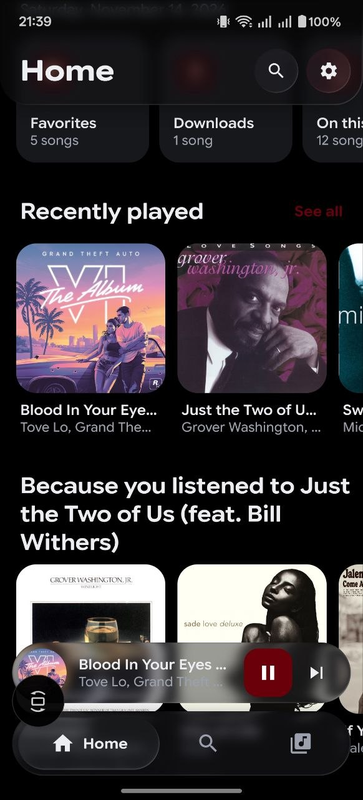
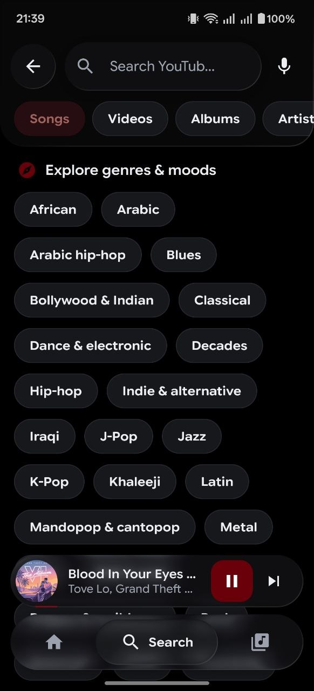
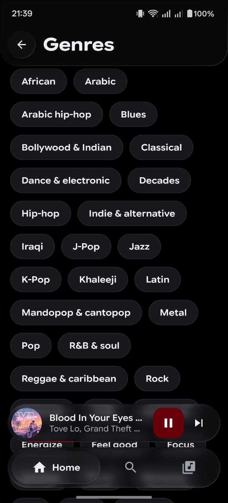
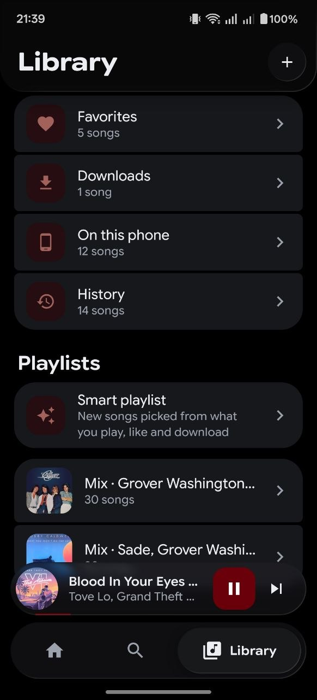
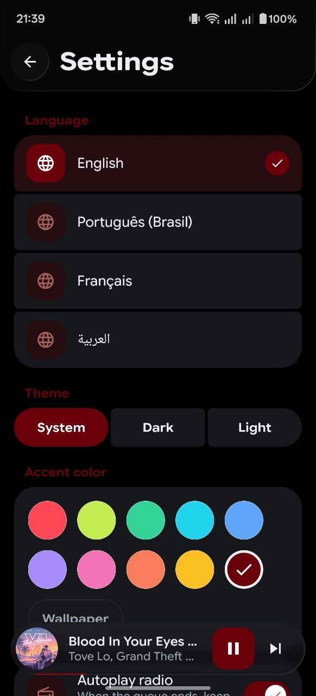

<div align="center">


# Medify

**Your music, uninterrupted.**

A native Android music player for YouTube Music's catalog: no ads, no account, no subscription, no computer.

<a href="https://github.com/Medamine-Bahassou/medify/releases/latest">
  
</a>


</div>

## Screenshots

<table>
  <tr>
    <td align="center"><br /><sub>Home</sub></td>
    <td align="center"><br /><sub>Search</sub></td>
    <td align="center"><br /><sub>Genres &amp; moods</sub></td>
  </tr>
  <tr>
    <td align="center"><br /><sub>Library</sub></td>
    <td align="center"><br /><sub>Settings</sub></td>
    <td></td>
  </tr>
</table>

## Features

- **Search** YouTube Music for songs, videos, albums and artists, with voice search
- **Browse** genres and moods, artist pages and full albums
- **Library:** favorites, playlists, history, smart playlist and mixes picked from what you play
- **Downloads:** save songs, albums or playlists and play them offline; also plays the music already on your phone
- **Autoplay radio** keeps going with similar songs when the queue ends
- Background playback with notification, lock screen and headphone controls
- **Themes:** system, dark or light, accent color presets or your wallpaper's colors, liquid-glass UI
- **Languages:** English, Português (Brasil), Français and العربية (right to left)
- Backup and restore your library to a file
- Works on Android TV too (same APK)

## Install

1. Download `Medify-<version>-Android.apk` from the [latest release](https://github.com/Medamine-Bahassou/medify/releases/latest).
2. Open it and allow installing from your browser or Files app. If Play Protect warns, tap **More details › Install anyway**.
3. To update, install the new APK over the old one. Your library stays.

Requires Android 7.0 or newer.

## Build from source

Needs JDK 21 and the Android SDK.

```bash
pnpm install
pnpm --filter @musike/mobile apk   # → release/Medify-<version>-Android.apk
```

The release APK is signed with `mobile/android/keystore.properties` (or the `MUSIKE_KEYSTORE*` environment variables) when present, the debug key otherwise.

The app lives in `mobile/android` (Kotlin, Jetpack Compose Material 3, Media3, OkHttp, Coil). The repository also contains the web, desktop and server code it was forked from.

## Release

Pushing a `v*` tag runs [`.github/workflows/release.yml`](.github/workflows/release.yml), which builds the APK and publishes it as a GitHub release. To sign it with a fixed key (so updates install over each other), set these repository secrets: `MUSIKE_KEYSTORE_BASE64`, `MUSIKE_KEYSTORE_PASSWORD`, `MUSIKE_KEY_ALIAS`, `MUSIKE_KEY_PASSWORD`.

## Legal notice

Medify is for **personal and educational use**. Playing YouTube content without ads goes against [YouTube's Terms of Service](https://www.youtube.com/t/terms). Don't offer it as a public service, don't monetize it, and respect the artists' rights.
